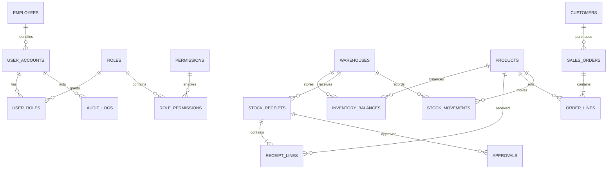

# Thiết kế ban đầu

Java 11, Spring Boot 2.7.18, JPA, Spring Security, MySQL 8 và Redis. Backend modular monolith; ID scalar giữa entity giúp tránh vòng tham chiếu JSON, lazy loading và N+1 ngoài ý muốn. Mapper tường minh cho danh mục; API chứng từ trả header, lines và approvals riêng.

## Sơ đồ dữ liệu

DDL chính xác nằm trong Flyway V1; quyền và kho ban đầu nằm trong V2. Mỗi tài khoản có nhiều vai trò, mỗi vai trò có nhiều quyền. API kiểm tra quyền trên server; quyền hiện tại là toàn hệ thống, chưa giới hạn theo kho/chi nhánh.

## Bất biến giao dịch

- Phiếu nhập PENDING → APPROVED sau 2 lần duyệt, hoặc REJECTED. Người lập, người duyệt 1 và người duyệt 2 khác nhau. Quyền mỗi tầng riêng. Khóa phiếu trước quyết định; unique receipt/level ngăn ghi trùng. Chỉ bước APPROVED tăng tồn, trong cùng transaction với sổ biến động và audit.
- Đơn bán PLACED → FULFILLED. Giá bán lấy từ DB thay vì tin giá gửi từ trình duyệt. Đặt hàng chưa giữ tồn. Khi xuất, khóa đơn và từng balance theo thứ tự product ID; thiếu bất kỳ sản phẩm nào rollback toàn giao dịch. Gửi lại fulfill đơn đã xuất không trừ tồn thêm.
- Balance có unique (warehouse_id,product_id); số lượng không âm. Ghi balance và movement nguyên tử. Movement unique (kind,document_id,product_id). OPENING cũng có movement để đối soát.
- Nhập mới bằng POST chưa có idempotency key: sau timeout cần kiểm tra danh sách trước khi tạo lại. Deadlock/timeouts trả lỗi để khách gọi kiểm tra rồi thử lại.
- Giá dùng DECIMAL(19,2), không dùng float trong DB/backend. Java long cho tồn; kiểm tra overflow.

## Hiệu năng và phạm vi

Danh mục sản phẩm phân trang keyset theo id, tìm SKU tiền tố; index unique SKU. Danh sách khác dùng page/size có giới hạn 100; lịch sử khách hàng có index (customer_id,id). Dashboard cache Redis 60 giây; truy vấn tổng hợp vẫn cần pre-aggregation nếu tải lớn. Không cache số tồn để quyết định xuất hàng.

Dữ liệu mặc định: 100.000 SKU, 20.000 khách, 100 nhân viên, 3 kho, 300.000 balances, 300.000 opening movements, 100.000 đơn và dòng đơn, 10.000 phiếu nhập và dòng nhập, 100.000 audit: 1.040.100 dòng (không tính quyền/kho/tài khoản). Đây là dữ liệu demo để thử truy vấn, không phải bằng chứng chịu tải production.

Chưa triển khai: thanh toán/công nợ, hủy/hoàn hàng, đặt mua nhà cung cấp riêng, giữ tồn, kiểm kê/điều chuyển, approval workflow động, phân quyền theo chi nhánh, MFA/SSO, audit đọc/xóa hoặc truy cập DB trực tiếp, tìm kiếm toàn văn, HA, backup tự động và job báo cáo. Audit hiện ghi thao tác thay đổi thành công qua các service.

Spring Boot 2.7 đã hết hỗ trợ cộng đồng; Java 11 giữ theo yêu cầu. Cần đánh giá hỗ trợ thương mại/cập nhật bảo mật trước production. Basic auth giữ trong bộ nhớ trình duyệt, không localStorage; bắt buộc TLS khi triển khai ngoài localhost. CSRF bật, BCrypt cho mật khẩu. Chưa có rate limit đăng nhập; thêm ở reverse proxy khi production. Mật khẩu demo không dùng cho production. MySQL TLS tắt chỉ trong mạng Compose cục bộ; DB bên ngoài phải bật TLS xác minh chứng chỉ.
